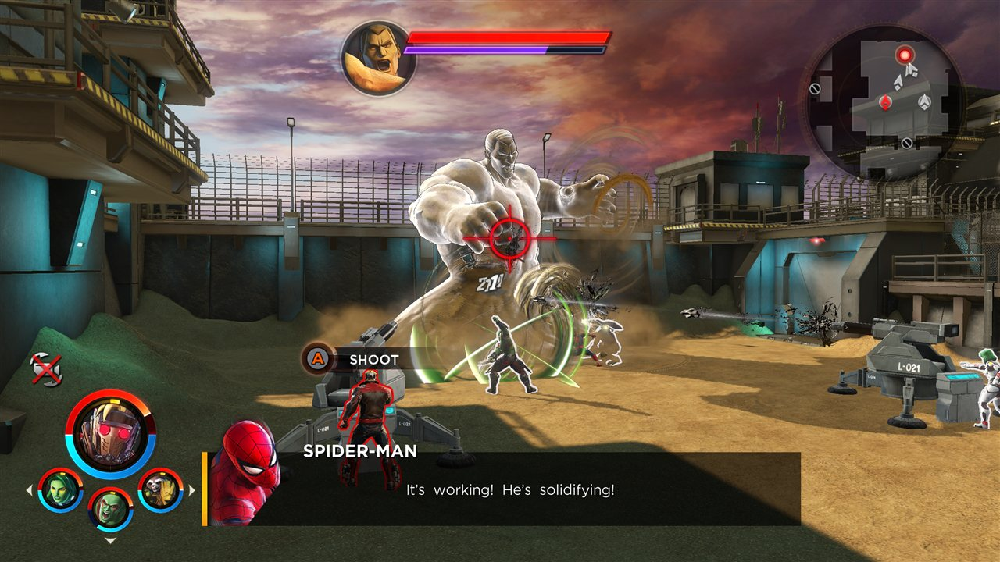
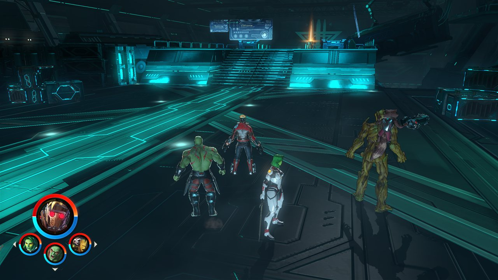
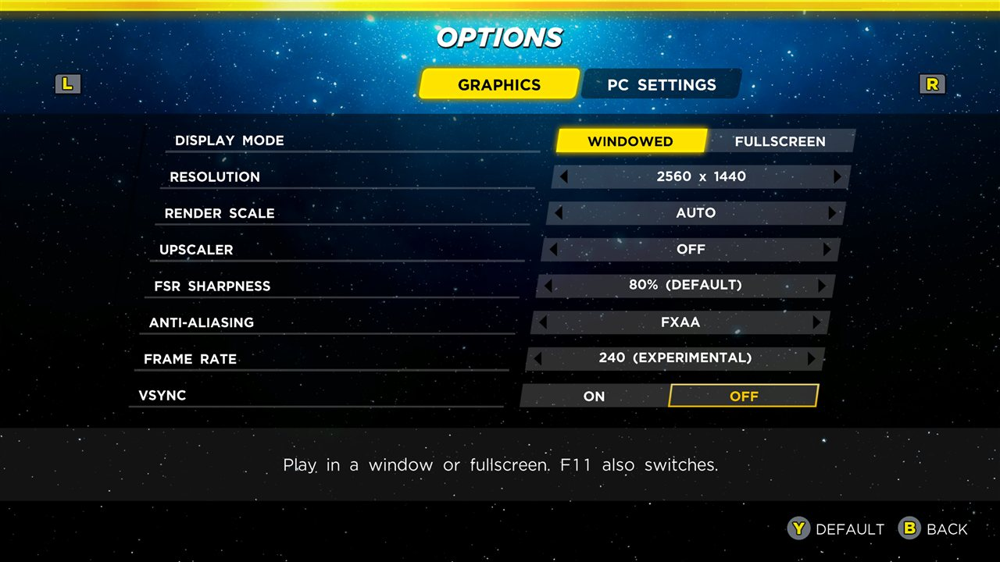

# MUA3 Native

**Marvel Ultimate Alliance 3: The Black Order, running natively on Windows.**
Higher resolutions, higher frame rates, mods, and no emulator.

<a href="https://recomplauncher.com"><picture><source media="(prefers-color-scheme: dark)" srcset="https://recomplauncher.com/assets/press/launcher/badge-light.svg"></picture></a>
&nbsp;

<table><tr>
<td></td>
<td></td>
</tr></table>

## What you get

- 🖥️ **Up to 4K**, sharp at your screen's real resolution
- ⚡ **30, 60, 120 fps or more**
- 🎮 Xbox, PlayStation and other controllers, or keyboard
- 🧩 **Mods** made for the Switch version (retextures, data and UI mods)
- ⚙️ All PC settings inside the game: **OPTIONS → GRAPHICS / PC SETTINGS**

> **You need your own copy of the game.** This project contains no game code, data or keys. The game is built on
> your PC from a dump of your own Switch.

## How to play

**What you need:** your Switch dump of the base game (`.nsp` / `.xci`), the 4.0.1 update, any DLC, and your
console's `prod.keys`.

1. **Download** the latest `MUA3Native-…-Windows-x64.zip` from
   [Releases](https://github.com/KaikoClanworth1/mua3-native/releases/latest) and unzip it (about 25 GB free needed).
2. **Run `MUA3Setup.exe`.** Point it at your game files and keys, and it builds the game for you. If your PC is
   missing Microsoft's free C++ build tools, it offers to install them.
3. **Play!**

Or just install it from [RecompLauncher](https://recomplauncher.com), which does all of this for you.

**Updating:** press **UPDATE NOW** in the launcher. Your saves, settings and mods are kept.
After an update, the game rebuilds its shaders for your GPU in the background, so expect a few minutes of
flicker or missing effects the first time.

## Mods

Put each mod's folder into `mods\` next to `mua3.exe` and start the game. Emulator and Atmosphere layouts work as
they are. Code patches and cheats can't apply to a native game. More in [docs/mods.md](docs/mods.md).

## Found a bug?

Please [open an issue](https://github.com/KaikoClanworth1/mua3-native/issues/new) and **always attach**:

1. 📄 **`mua3.log`** from the game's folder (next to `mua3.exe`)
2. 📸 **Screenshots** of the problem (**F12** takes one in-game), and where in the game it happened
3. 💻 Your **GPU** and **Windows version**

Without the log we usually can't tell what went wrong.

## For developers

How the port works and how to build it from source: [docs/building.md](docs/building.md).

## Support the project

If you enjoy the port: [Patreon](https://www.patreon.com/c/KaikoClanworth) ·
[Ko-fi](https://ko-fi.com/kaikoclanworth) ·
[PayPal](https://www.paypal.com/donate/?hosted_button_id=MS4C2WC38N3W2)

## Legal

*Marvel Ultimate Alliance 3: The Black Order* is © MARVEL, © Nintendo, developed by KOEI TECMO GAMES. This is an
unofficial fan project, not affiliated with or endorsed by them. It contains no game code, data or keys; use it only
with a game you own, dumped from your own console. Screenshots are from the game running on this port.

Third-party code

[dynarmic](https://github.com/azahar-emu/dynarmic) (0BSD; its A64 decoder and IR are used by the recompiler),
[SDL3](https://github.com/libsdl-org/SDL) (zlib), [Dear ImGui](https://github.com/ocornut/imgui) (MIT),
[Boost](https://www.boost.org) (BSL-1.0), AMD [FidelityFX FSR 1](https://github.com/GPUOpen-Effects/FidelityFX-FSR) and
[FSR 3.1](https://github.com/GPUOpen-LibrariesAndSDKs/FidelityFX-SDK) (MIT, `third_party/ffx_fsr1`, `third_party/ffx_fsr3`).
Font: [Exo 2](https://github.com/googlefonts/Exo-2.0) by Natanael Gama and The Exo 2 Project Authors (SIL Open Font
License 1.1, `third_party/fonts/exo2/`), used by the launcher.

NVIDIA DLSS: the optional DLSS upscaler (`mua3_dlss.dll`) uses NVIDIA's DLSS SDK, which is proprietary and not part of
this repository: builds include it only where the SDK is placed in `third_party/dlss`. NVIDIA, DLSS and the NVIDIA
logo are trademarks of NVIDIA Corporation. AMD FidelityFX and FSR are trademarks of Advanced Micro Devices, Inc.

